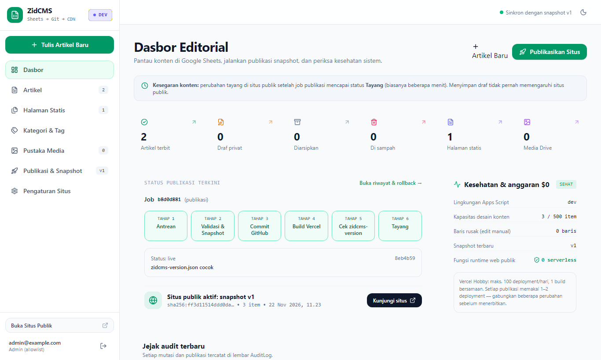
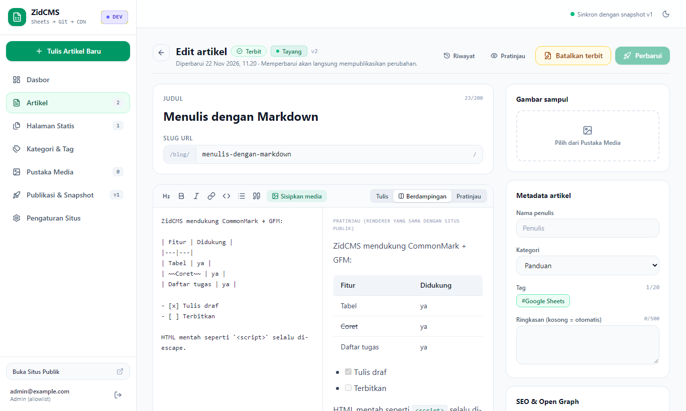
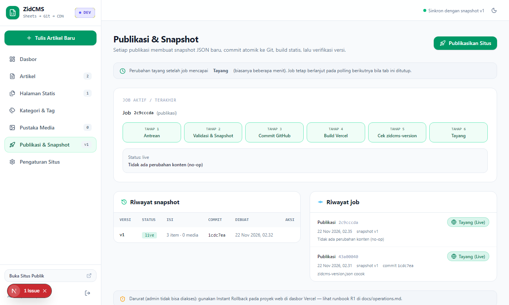
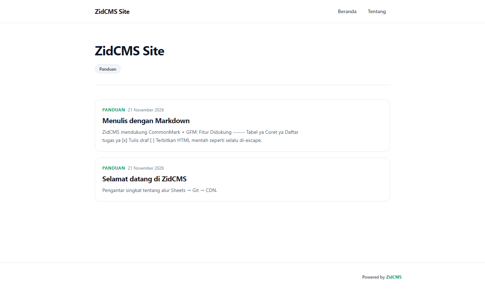

# ZidCMS

**Publish from Sheets. Serve at scale.**

[](https://github.com/zidnammc/zidcms/actions/workflows/ci.yml) [](https://devin.ai) [](https://poke.com) [](LICENSE)

ZidCMS is an open-source, spreadsheet-native headless CMS. You write in a web dashboard, your content lives in a Google Sheet you own, and readers get a fast static website.

## Features

- **Write in a real editor:** Markdown with live preview, drafts, cover images, categories, tags, static pages and SEO fields.
- **Your data stays yours:** posts are rows in your own Google Sheet; images stay private in your Google Drive.
- **Publishing you can trust:** every publish creates a versioned snapshot in Git, rebuilds the site and checks that the new version is live. A failed build never breaks the site, and any earlier version can be restored in one click.
- **Fast, cheap public site:** fully static pages on a CDN; readers never touch Sheets, Apps Script or a server.
- **Free to run:** Vercel Hobby, GitHub Free and a normal Google account. One allowlisted admin account signs in with Google.

> **Status: early stage.** v0.1.0 is an early-stage release and may be developed further. It is a non-commercial open-source experiment, not a WordPress replacement. Built by [Devin](https://devin.ai) (Cognition) using Devin AI Max access provided by [Poke](https://poke.com), planned and directed by the project owner. See the [limitations](docs/limitations.md) and the [changelog](CHANGELOG.md).

## Screenshots

| Admin dashboard                                          | Editor (Markdown, live preview)                |
| -------------------------------------------------------- | ---------------------------------------------- |
|  |    |
| **Publishing & snapshots**                               | **Public site**                                |
|     |  |

The admin UI is in **Bahasa Indonesia**. This README quotes on-screen labels exactly, with the English meaning in brackets.

---

## How to use ZidCMS

There are three ways to meet ZidCMS. Pick the one you need:

| I want to…                                         | Go to                                                                             | Time      | Accounts needed               |
| -------------------------------------------------- | --------------------------------------------------------------------------------- | --------- | ----------------------------- |
| try it on my computer                              | [1. Try it locally](#1-try-it-locally)                                            | ~10 min   | none                          |
| run my own site online for free                    | [2. Put your own ZidCMS online](#2-put-your-own-zidcms-online)                    | 1–2 hours | GitHub, Google, Vercel        |
| write and publish on a site that is already set up | [3. Everyday use: writing and publishing](#3-everyday-use-writing-and-publishing) | none      | an allowlisted Google account |

Never used a terminal, GitHub or Vercel? The [Beginner Guide](docs/beginner-guide.md) explains every click in detail.

### 1. Try it locally

You need **Node.js 26**, **Git** and **pnpm 12** (`npm install -g pnpm@12.21.0`). No Google, GitHub or Vercel account is needed: a built-in emulator stands in for Google Sheets and Apps Script.

```bash
git clone https://github.com/zidnammc/zidcms.git
cd zidcms
pnpm install
pnpm init:local      # creates apps/admin/.env.local with random local keys
```

Start the three parts, each in its own terminal, and leave them running:

```bash
pnpm dev:gas         # terminal 1: Sheets + Apps Script emulator (http://localhost:8787)
pnpm dev:web         # terminal 2: public site            (http://localhost:3001)
pnpm dev:admin       # terminal 3: admin dashboard        (http://localhost:3000)
```

Then:

1. Open <http://localhost:3000>. In the purple **Dev login** box type `admin@example.com` and click **Masuk** (Sign in).
2. Optional sample content: in a fourth terminal run `pnpm seed`, then reload the dashboard.
3. Click **Publikasikan Situs** (Publish Site) and wait until the job shows **Tayang** (Live). Locally this takes a few seconds.
4. Open <http://localhost:3001>: that is your static public site.
5. Now follow [section 3](#3-everyday-use-writing-and-publishing) to write your own post.

Stop everything with **Ctrl + C** in each terminal. To start over: stop the servers, delete the `.local/` folder and run `pnpm reset:content`.

### 2. Put your own ZidCMS online

Everything runs on free plans (Vercel Hobby, GitHub Free, a normal Google account) and on **your own** accounts. The full click-by-click walkthrough is [Beginner Guide, Part 3](docs/beginner-guide.md#part-3-putting-zidcms-online-free); this is the overview:

| Step | What you do                                                                                                                                                                                                             | Guide |
| ---- | ----------------------------------------------------------------------------------------------------------------------------------------------------------------------------------------------------------------------- | ----- |
| 1    | Create a **public GitHub repository** with this code and turn on secret scanning + push protection.                                                                                                                     | 3.1   |
| 2    | Create a **fine-grained GitHub token** for that repo only (_Contents: read & write_, _Commit statuses: read_).                                                                                                          | 3.2   |
| 3    | Generate two random keys: `HMAC_SECRET` and `AUTH_SECRET`.                                                                                                                                                              | 3.3   |
| 4    | Create a **Google Sheet**, open _Extensions → Apps Script_, set the Script Properties `HMAC_SECRET` and `ENVIRONMENT=prod`, enable the Apps Script API.                                                                 | 3.4   |
| 5    | Upload the Apps Script code with `clasp` (`pnpm build` in `services/apps-script`, then `clasp push`).                                                                                                                   | 3.5   |
| 6    | Deploy it as a **web app** (_Execute as: Me_, _Who has access: Anyone_; every request must be HMAC-signed), copy the `/exec` URL, run `setup` once.                                                                     | 3.6   |
| 7    | Create two **Vercel Hobby projects** from your repo: `apps/web` (env `SITE_URL`, `ZIDCMS_ENV=prod`) and `apps/admin`.                                                                                                   | 3.7   |
| 8    | Create a **Google OAuth client** (consent screen _External_, you as test user) with the redirect URI `https://<your-admin>.vercel.app/api/auth/callback/google`, and enable the Google Drive API in that Cloud project. | 3.8   |
| 9    | Fill in the admin project's environment variables (`AUTH_*`, `ADMIN_EMAILS`, `GAS_*`, `GITHUB_*`, `PUBLIC_SITE_URL`, `VERCEL_STATUS_CONTEXT`, …) and redeploy.                                                          | 3.9   |
| 10   | Sign in with Google, write a post, click **Terbitkan** (Publish) and watch it go live.                                                                                                                                  | 3.10  |

Rules that matter:

- Put **only your own Google account** in `ADMIN_EMAILS`, and never commit it or any secret: the repository is public.
- If Google answers the Apps Script authorization with `Error 403: access_denied`, link the script to your own Google Cloud project (_Project Settings → Change project_); see [troubleshooting](docs/beginner-guide.md#part-4-troubleshooting).
- Vercel Hobby allows 100 deployments per day; each publish costs one or two. Bundle changes instead of publishing every small edit.

Maintainers who want separate dev and prod environments, scripted installs and promotion between branches: [`docs/setup.md`](docs/setup.md), [`docs/deployment.md`](docs/deployment.md) and [`docs/operations.md`](docs/operations.md).

### 3. Everyday use: writing and publishing

Open your admin address and click **Masuk dengan Google** (Sign in with Google). Accounts that are not in `ADMIN_EMAILS` see **"Akses ditolak"** (Access denied).

**Write a post**

1. Click **Tulis Artikel Baru** (Write New Post).
2. Type the **Judul** (Title); the **Slug URL** fills in by itself (`/blog/<slug>/`, lowercase letters, digits and hyphens).
3. Write the content in **Markdown**. The toolbar adds headings, bold, links, lists and quotes; **Berdampingan** (Side by side) shows the result next to the editor using the same renderer as the public site.
4. Optional, in the right-hand panel: cover image, author, category, tags, excerpt, and the SEO title/description with character counters.
5. Click **Simpan draf** (Save draft). Drafts are stored in Google Sheets and **never** change the public site.
6. Click **Pratinjau** (Preview) to see the post exactly as it will look.

**Publish**

1. Click **Terbitkan** (Publish).
2. Watch the pipeline in the top bar or under **Publikasi & Snapshot** (Publishing & Snapshots): _Antrean_ (queued) → _Validasi & Snapshot_ → _Commit GitHub_ → _Build Vercel_ → _Cek zidcms-version_ → **Tayang** (Live). Online this takes about 1–1.5 minutes.
3. You may close the tab; the job continues the next time the dashboard is open. Several publishes close together are merged into one job.
4. Check `https://<your-site>/zidcms-version.json`: its `version` equals the snapshot version shown in the dashboard.

**Change or remove published content**

| To…                            | Do this                                                                                                           |
| ------------------------------ | ----------------------------------------------------------------------------------------------------------------- |
| update a live post             | Edit it and click **Perbarui** (Update). The change is published immediately.                                     |
| rework a post privately        | Click **Batalkan terbit** (Unpublish) first; it leaves the site and becomes a draft. Publish again when ready.    |
| keep a post without showing it | **Arsipkan** (Archive). Revive it with **Pindahkan ke draf** (Move to draft).                                     |
| delete / restore               | **Pindahkan ke sampah** (Move to trash); restore from **Artikel → Sampah → Pulihkan** (Posts → Trash → Restore).  |
| undo a bad publish             | **Publikasi & Snapshot → Rollback** on an earlier version → **Ya, rollback**. It is republished as a new version. |

**Images, pages, taxonomy and settings**

- **Pustaka Media** (Media Library): upload JPG/PNG/WebP/GIF up to 3 MB, add alt text, then insert with **Sisipkan media** (Insert media) in the editor. Originals stay private in Google Drive; only images used by published content are copied to the site.
- **Halaman Statis** (Static Pages): pages such as `/about/`; set **Urutan di menu header** (header menu order) to show them in the site menu.
- **Kategori & Tag** (Categories & Tags) and **Pengaturan Situs** (Site Settings: title, description, language, posts per page, default author, footer). These changes go live with the next **Publikasikan Situs** (Publish Site).

**If something goes wrong**

- A failed publish (e.g. `DEPLOY_FAILED`) never breaks the site: the previous version stays live. Read the message in **Publikasi & Snapshot** and publish again.
- "Item ini telah diubah di tempat lain" (changed elsewhere) means someone saved the same post in another tab: copy your text, reload, and paste it back.
- Don't edit the Google Sheet by hand; invalid rows are skipped and reported.
- More answers: [Beginner Guide, Part 4](docs/beginner-guide.md#part-4-troubleshooting) and [`docs/operations.md`](docs/operations.md).

---

## How it works

```text
Admin browser ──► apps/admin (Next.js) ──HMAC RPC──► services/apps-script ──► Sheets / Drive
                         │
                         └── GitHub Git Data API ──► apps/web/content/<env>/       ──► Vercel static build ──► Readers
```

Every publish builds a snapshot of the published content only (allowlisted fields, no admin e-mail), commits it to Git, lets Vercel rebuild the static site, and confirms the new `zidcms-version.json` is live before reporting **Tayang**. Details: [`docs/architecture.md`](docs/architecture.md) and the [decision records](docs/decisions/).

## Repository layout

| Path                   | Contents                                                                                                                                                                             |
| ---------------------- | ------------------------------------------------------------------------------------------------------------------------------------------------------------------------------------ |
| `packages/core`        | Shared, framework-free domain logic: types, sheet schema + codec, validators, slugs, status transitions, RPC envelope + verification, snapshot builder + checksum, Markdown renderer |
| `services/apps-script` | GAS dispatcher, actions, GAS adapters, in-memory adapters, local GAS emulator, esbuild bundle                                                                                        |
| `apps/admin`           | Admin dashboard (Auth.js + allowlist, HTTP API, publish orchestrator, UI in Bahasa Indonesia)                                                                                        |
| `apps/web`             | Static public site generated from `content/<env>/snapshot.json`                                                                                                                      |
| `scripts`              | setup, seed, smoke tests, deployed checks, PoCs, secret scan, static-output check                                                                                                    |
| `tests`                | integration suite, Playwright E2E, load-test scripts and raw results                                                                                                                 |
| `docs`                 | beginner guide, architecture, API, security, setup, deployment, operations, testing, limitations, benchmarks, ADRs, status reports                                                   |

## Environments

The reference deployment has one hosted environment, **prod**: it builds from `release` and publishes to `apps/web/content/prod/`; `main` carries code only and creates no Vercel deployments. The dev/staging environment was retired on 2026-11-22 (ADR-0012); the code stays multi-environment (`ZIDCMS_ENV=dev|prod`), so a staging environment can be recreated. See [`docs/deployment.md`](docs/deployment.md), ADR-0011 and ADR-0012.

## Development and quality gates

`pnpm lint && pnpm typecheck && pnpm test && pnpm build && pnpm check:web && pnpm scan:secrets`: the same steps run in [`.github/workflows/ci.yml`](.github/workflows/ci.yml). `pnpm test:integration` and `pnpm test:e2e` run against the local emulator stack (also available as manual GitHub workflows); see [`docs/testing.md`](docs/testing.md). How to contribute: [`CONTRIBUTING.md`](CONTRIBUTING.md). Security reports: [`SECURITY.md`](SECURITY.md).

## Documentation

[Beginner guide](docs/beginner-guide.md) · [Architecture](docs/architecture.md) · [API](docs/api.md) · [Security](docs/security.md) · [Testing](docs/testing.md) · [Setup](docs/setup.md) · [Deployment](docs/deployment.md) · [Operations](docs/operations.md) · [Limitations](docs/limitations.md) · [Benchmarks](docs/benchmarks.md) · [Decisions](docs/decisions/) · [Project history](docs/history/) · [Changelog](CHANGELOG.md) · [Contributing](CONTRIBUTING.md)

## Hosting note

The reference deployment runs on Vercel Hobby, GitHub Free, and a free Google account ($0 budget). Vercel Hobby is for non-commercial use; this project stays a non-commercial experiment.

## Acknowledgments

ZidCMS was developed using Devin AI Max access provided by Poke.

- **[Poke](https://poke.com)** provided the Devin AI Max access that made this sprint possible.
- **[Devin](https://devin.ai)** (Cognition) executed the work: code, tests, infrastructure setup, benchmarks and documentation, working from the owner's plan and decisions. Commits made by Devin are authored as `devin-ai-integration[bot]`; the process, findings and limits of this AI-executed sprint are described in the [retrospective](docs/history/retrospective.md).

## License

Copyright 2026 The ZidCMS Authors. Licensed under the [Apache License, Version 2.0](LICENSE). See [`NOTICE`](NOTICE).
